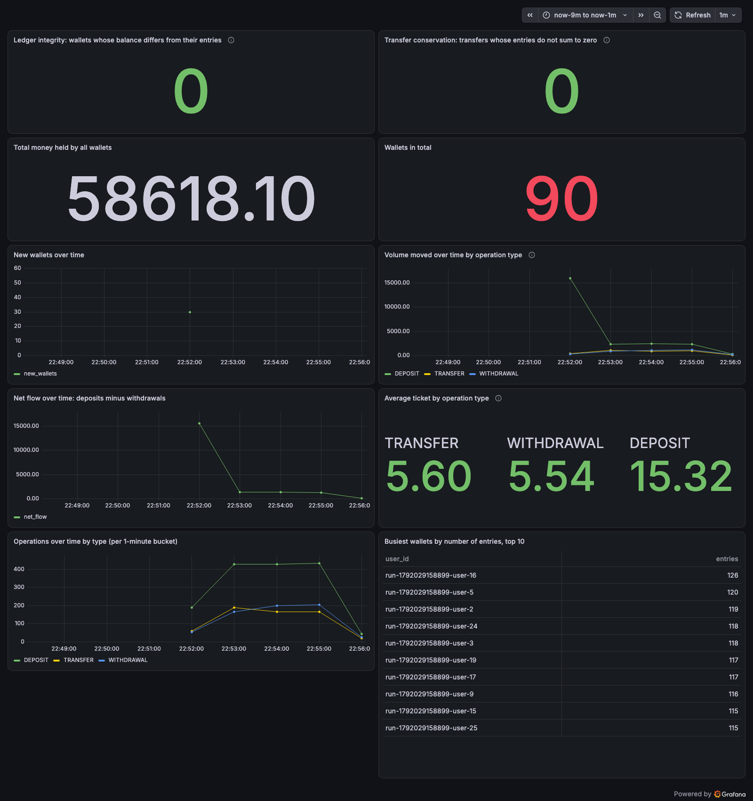
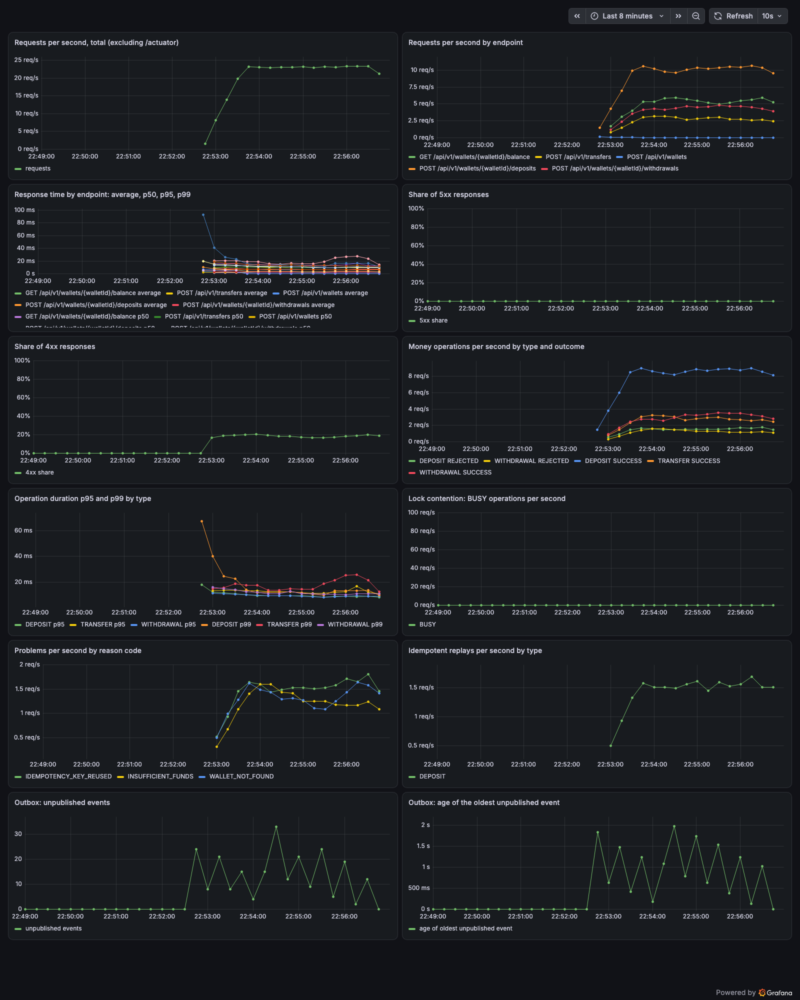
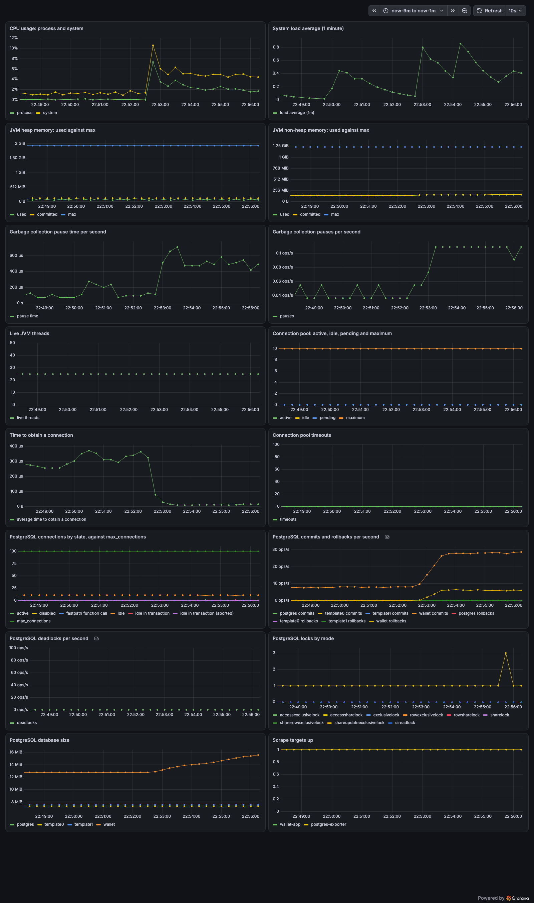

# Monitoring

[← Back to the README](../README.md)

`docker compose --profile monitoring up -d` adds Prometheus and Grafana to the running stack. Prometheus scrapes the application and the PostgreSQL exporter every 5 seconds; Grafana is anonymous and read-only, with its home dashboard set to "Wallet — Business". The extra host ports come from the same environment variables as the rest of the stack: `WALLET_PROMETHEUS_PORT` (default 9090) and `WALLET_GRAFANA_PORT` (default 3000).

| URL | What |
|---|---|
| `http://localhost:3000/d/wallet-business` | Grafana: Wallet — Business (the home dashboard) |
| `http://localhost:3000/d/wallet-service` | Grafana: Wallet — Service |
| `http://localhost:3000/d/wallet-runtime-database` | Grafana: Wallet — Runtime and Database |
| `http://localhost:9090` | Prometheus: graph, targets and status |

**Wallet — Service** shows the API as a caller experiences it: request rate by endpoint, response time average, p50, p95 and p99, the share of 4xx and 5xx answers, money operations per second by type and outcome, operation duration percentiles, the `WALLET_BUSY` rate, problem answers by code, idempotent replays by type, and the outbox backlog and lag.

**Wallet — Runtime and Database** shows the machinery underneath: CPU and load, JVM heap and non-heap memory, garbage collection, live threads, the HikariCP connection pool, and PostgreSQL connections, commits, rollbacks, deadlocks, locks and database size.

**Wallet — Business** shows the money itself, straight from the database through the read-only `grafana_reader` role: the two ledger integrity checks, total money held, wallet counts and creation rate, volume moved and net flow over time, the average ticket per operation type, and the busiest wallets.

The signals that matter most:

| Signal | Dashboard | What a bad value means |
|---|---|---|
| p99 response time | Wallet — Service | The slowest 1% of requests is growing: wallets are queueing on their row lock, or the database is under pressure. |
| 5xx share | Wallet — Service | 500s are service failures; a rising share of 503 `WALLET_BUSY` means lock contention past the 2-second timeout. |
| BUSY rate | Wallet — Service | Requests waited too long for a wallet lock. Retrying with the same key is safe, but a sustained rate means one wallet is too hot. |
| Pool pending | Wallet — Runtime and Database | Requests are queueing for a database connection: the pool is saturated or the database has slowed down. |
| Outbox age | Wallet — Service | The oldest unpublished event is aging: event delivery is falling behind the operations. |
| Ledger integrity, transfer conservation | Wallet — Business | Above zero, a balance no longer matches its ledger entries or a transfer no longer conserves money. This is the audit invariant; investigate immediately. |

The two integrity queries scan whole tables, so they are fine for this small stack but would run against a replica in production, never against the primary.

The dashboards open on the last 15 minutes, so the request and operation panels show flat lines unless traffic is running; the load command below fills them. A small load generator ships under the `load` compose profile (it never starts with `docker compose up` or `--profile monitoring` alone). With the stack up, run it on demand; it prints its summary and exits:

```bash
docker compose run --rm k6
```

It waits for readiness, creates and funds 30 wallets, then sends about 20 requests per second for 3 minutes: deposits, withdrawals, transfers and balance reads, plus a small share of idempotent replays, reused idempotency keys, withdrawals beyond the balance and requests for an unknown wallet. Length, pace and wallet count come from `WALLET_LOAD_DURATION` (default `3m`), `WALLET_LOAD_RATE` (default `20`) and `WALLET_LOAD_WALLETS` (default `30`).

## Screenshots

Taken with the stack up while `docker compose run --rm k6` was running.

### Wallet — Business



### Wallet — Service



### Wallet — Runtime and Database


